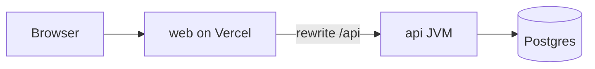
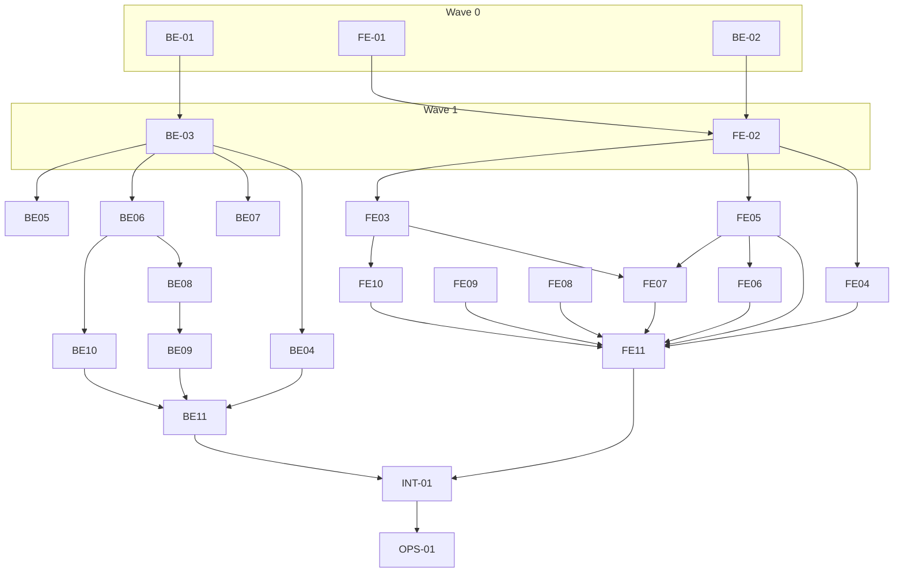

# ClearPath Review — Implementation

Build spec derived from [DESIGN.md](./DESIGN.md). Where this doc and the design disagree, change the design first; this file is the engineering contract for implementation.

---

## 1. Architecture

### 1.1 Repo layout

| Path | Purpose |
| --- | --- |
| `web/` | Next.js (App Router), TypeScript, Tailwind, shadcn/ui, TanStack Query, `react-pdf`, MSW |
| `api/` | Spring Boot 3, Java 21, Gradle, Flyway, JDBC/JPA, PDFBox (seed PDFs), Testcontainers |
| `contracts/openapi.yaml` | Single source of truth for the HTTP API |
| `docker-compose.yml` | Postgres 16 for local dev |

The browser talks only to the Next.js origin. `web/next.config` rewrites `/api/*` → `API_URL` (Spring). Session cookie is `HttpOnly`, `SameSite=Lax`, scoped to the web origin so the proxy keeps auth simple (no CORS).

PDF bytes live in Postgres (`file_blob.bytes`), not object storage, for demo simplicity.



### 1.2 Hosting (free tier)

**What Vercel Hobby ($0) can host**

| Works on Vercel free | Does not work on Vercel free |
| --- | --- |
| Next.js frontend (`web/`) — static assets, SSR, App Router | Long-running **Java / Spring Boot** (`api/`) |
| Serverless/edge **Node** backends (Express, Hono, NestJS, etc.) via [Backends on Vercel](https://vercel.com/docs/frameworks/backend) | Managed **Postgres** (no DB on Hobby; Blob/Storage are separate paid products) |
| Rewrites/proxy to an external API URL | JVM, Docker containers, or always-on processes |

Vercel’s free tier is aimed at personal, non-commercial use ([Hobby plan](https://vercel.com/docs/plans/hobby)): generous for the Next app, not a home for Spring or Postgres.

**Recommended free split (matches DESIGN stack)**

| Piece | Provider | Notes |
| --- | --- | --- |
| `web/` | **Vercel Hobby** | Connect GitHub; set `API_URL` to the deployed Spring base URL |
| `api/` | **Render free web service** or **Railway** (trial/credits) or **Fly.io** | Spring Boot JAR or Docker; expect cold starts on free Render |
| Postgres | **Neon free** or **Supabase free** or **Render free Postgres** | Connection string in Spring `DATABASE_URL`; run Flyway on deploy |

**Local:** `docker-compose up` for Postgres; run `api` on `:8080`, `web` on `:3000` with `API_URL=http://localhost:8080`.

**If everything must stay on Vercel only:** you would replace `api/` with Next.js Route Handlers (or a Vercel-supported Node framework) and Neon — that is a different architecture; this doc assumes Spring + Postgres as in DESIGN.

---

## 2. Confirmed product decisions

| Topic | Decision |
| --- | --- |
| Newer file on top of an older approved version | **Material list status** follows the **current version** (per DESIGN: unsubmitted file → **Draft**). Do **not** show a banner on the material view calling out “approved-for-use is an older version.” Users switch versions in the version switcher; each version shows its own review outcome (e.g. v1 **Approved** with until-date, v2 **Draft**, v3 **In review**). `approved_version_id` on the material remains for queries and version metadata only. |
| Obsolete | Sets `obsolete_at`, abandons any active cycle, final. |
| PDF storage | Postgres `bytea` via `file_blob`. |
| Expiry | No cron; `approved_until` evaluated on read; lazy insert of owner “expired” notifications (see §4.4). |
| Permissions | No admin role; group membership gates **approval** only. |

---

## 3. Database

Flyway: `api/src/main/resources/db/migration/V1__init.sql`. IDs: `uuid`. Timestamps: `timestamptz`.

### 3.1 Tables

**Identity & config**

- `app_user` — `id`, `name`, `email` (unique), `password_hash`, `created_at`
- `user_group` — `id`, `name` (unique)
- `membership` — `user_id`, `group_id`, PK `(user_id, group_id)`
- `product` — `id`, `name` (unique), `approval_lifetime_days` (check `> 0`)
- `workflow_step` — `id`, `product_id`, `position`, `name`, unique `(product_id, position)`
- `step_requirement` — `id`, `step_id`, `group_id`, `approvals_required` (check `>= 1`), unique `(step_id, group_id)`

**Files & materials**

- `file_blob` — `id`, `content_type`, `bytes` (bytea), `size`, `sha256`, `created_at`
- `material` — `id`, `product_id`, `owner_id`, `title`, `channel` (`email|web|affiliate|social`), `audience` (`consumer|partner`), `intended_use`, `current_version_id` (FK nullable until first version), `approved_version_id`, `approved_at`, `approved_until`, `obsolete_at`, `expiry_notified_at`, `created_at`, `updated_at`
- `material_version` — `id`, `material_id`, `number`, `file_id`, `file_name`, `uploaded_by`, `uploaded_at`, `note`, unique `(material_id, number)`

**Review**

- `review_cycle` — `id`, `material_id`, `version_id`, `status` (`active|abandoned|completed`), `current_position`, `approval_lifetime_days` (snapshot from product at start), `started_by`, `started_at`, `ended_at`
- Partial unique index: one `active` cycle per material
- `cycle_step` — `id`, `cycle_id`, `position`, `name`, `opened_at`, `completed_at`, unique `(cycle_id, position)`
- `cycle_requirement` — `id`, `cycle_step_id`, `group_id`, `group_name`, `approvals_required`
- `review` — `id`, `cycle_id`, `position`, `group_id`, `user_id`, `counted` (bool), `decided_at`, unique `(cycle_id, position, group_id, user_id)`

**Social**

- `comment` — `id`, `version_id`, `author_id`, `body`, `created_at`
- `activity` — `id`, `material_id`, `actor_id`, `type`, `detail` (jsonb), `created_at`
- `favorite` — `user_id`, `material_id`, PK `(user_id, material_id)`
- `notification` — `id`, `user_id`, `material_id`, `actor_id`, `kind`, `detail` (jsonb), `read_at`, `created_at`; index `(user_id, created_at desc)`

### 3.2 Material status (library / summary)

Computed in SQL view `material_status_v` — **for the current version and material-level flags**, not “newest approved wins”:

1. If `obsolete_at` is set → `obsolete`
2. Else if exists `review_cycle` with `status = 'active'` for `current_version_id` → `in_review`
3. Else if `current_version_id = approved_version_id` and `approved_until > now()` → `approved`
4. Else if `current_version_id = approved_version_id` and `approved_until <= now()` → `expired`
5. Else → `draft`

Past approved versions do not change this summary when a newer draft exists (summary is **Draft**).

### 3.3 Per-version status (detail / version switcher)

For each `material_version`:

| Condition | Label |
| --- | --- |
| Version has a `completed` cycle | `approved` (+ `approved_until` from material if this version is `approved_version_id`) |
| Version has an `active` cycle | `in_review` |
| Otherwise | `draft` |

UI shows this on each entry in the version switcher. Selecting a version loads its PDF, comments, and stepper for **that** version’s active or last cycle.

### 3.4 Task list queries (not stored)

**Your tasks (`tab=mine`)** — rows for current user:

- Active cycle on material’s **current** version
- Open step = cycle’s `current_position`
- User is in a group with a requirement on that step
- User has not submitted an approval for `(cycle, position, group)` **or** group quota already met (then row drops off per DESIGN)
- Group’s counted approvals `< approvals_required`

**Your workflows (`tab=workflows`)** — `owner_id = me` and summary status in (`draft`, `in_review`).

**Upcoming (`tab=upcoming`)** — active cycle, user in a group on a **future** step, no approvable row on current step.

Each row includes `days_waiting` from open step’s `opened_at`; `overdue = days_waiting > 3`.

---

## 4. Backend behavior

### 4.1 Review engine

**Start review** (`POST .../review/start`) on current version:

- Reject if obsolete, no current version, or active cycle exists
- For each requirement on step 1 (from product template), `count(membership) >= approvals_required` else `409 GROUP_TOO_SMALL` with group name
- Insert cycle + snapshot `cycle_step` / `cycle_requirement` from product; open step 1; write activity + notifications

**Approve** (`POST .../approvals` `{ groupId }`):

- `SELECT review_cycle ... FOR UPDATE`
- Verify active cycle, open step requires group, user in group
- Insert review; `counted = (current counted count for group on step < required)`
- If all requirements on step satisfied → complete step, open next or complete cycle
- **Complete cycle:** set `material.approved_version_id = version_id`, `approved_at`, `approved_until = now() + approval_lifetime_days` (from cycle snapshot)

**New version** (`POST .../versions` multipart):

- New `material_version`, bump number, set `current_version_id`
- If active cycle → mark `abandoned`, start new cycle at step 1 on new version (activity: restart)
- Do **not** change `approved_version_id` until a cycle completes on a version

**Product change** on material: allowed only if material has never had a `review_cycle`.

**Obsolete:** abandon active cycle, set `obsolete_at`.

### 4.2 Events

| Trigger | Activity type | Bell recipients |
| --- | --- | --- |
| Step opens | `step_opened` | All users in groups on that step |
| Comment created | `comment_added` | Material owner (not author) |
| Approval recorded | `approved` | Owner (not approver) |
| Step completed | `step_completed` | Owner |
| Cycle completed | `fully_approved` | Owner |
| Lazy expiry pass | `expired` | Owner |
| Obsolete | `obsolete` | Owner |

Bell rows are independent of task rows.

### 4.3 Lazy expiry notifications

On `GET /api/materials` and `GET /api/materials/{id}`:

```sql
UPDATE material
SET expiry_notified_at = now()
WHERE approved_version_id IS NOT NULL
  AND approved_until <= now()
  AND expiry_notified_at IS NULL
  AND obsolete_at IS NULL
RETURNING id, owner_id;
```

For each returned row, insert owner notification kind `material_expired` once.

### 4.4 Auth (demo)

- Seed users share password `demo-demo` (document in README)
- `POST /api/session/login` `{ email, password }` → session cookie
- `POST /api/session/switch` `{ userId }` — demo only; requires existing session
- Spring filter resolves `CurrentUser` on all `/api/**` except login

Session payload: `{ userId, exp }` HMAC-signed (`SESSION_SECRET`).

---

## 5. HTTP API contract

OpenAPI 3.1 in [`contracts/openapi.yaml`](./contracts/openapi.yaml) (owned by ticket BE-02). Conventions:

- Base path: `/api`
- JSON bodies/responses: **camelCase**
- Times: ISO-8601 UTC
- Errors: `{ "error": { "code", "message", "details" } }`

| Code | HTTP | When |
| --- | --- | --- |
| `VALIDATION` | 400 | Bean validation |
| `UNAUTHORIZED` | 401 | No session |
| `NOT_GROUP_MEMBER` | 403 | Approve without membership |
| `NOT_FOUND` | 404 | Missing resource |
| `GROUP_TOO_SMALL` | 409 | Start review |
| `CYCLE_ALREADY_ACTIVE` | 409 | Start review |
| `NO_ACTIVE_CYCLE` | 409 | Approve |
| `ALREADY_APPROVED` | 409 | Duplicate approve same group/step |
| `PRODUCT_LOCKED` | 409 | PATCH product after first cycle |
| `MATERIAL_OBSOLETE` | 409 | Mutations on obsolete |

### 5.1 Endpoints (summary)

**Session**

- `GET /session` → `{ user: SessionUser \| null }`
- `POST /session/login`, `POST /session/switch`, `POST /session/logout`

**Setup**

- `GET|POST /users`, `PATCH /users/{id}` (body includes `groupIds`)
- `GET|POST /groups`, `PATCH /groups/{id}`, `PUT /groups/{id}/members`
- `GET|POST /products`, `GET|PUT /products/{id}` (full nested steps + requirements)

**Materials**

- `GET /materials?q&productId&status&channel&owned&favorites`
- `POST /materials` — `multipart`: `title`, `productId`, `channel`, `audience`, `intendedUse`, `file`, `startReview`
- `GET|PATCH /materials/{id}`
- `POST /materials/{id}/versions` — multipart `file`, optional `note`, `startReview` (default true if cycle was active)
- `GET /versions/{versionId}/file` → `application/pdf`
- `POST /materials/{id}/review/start`
- `POST /materials/{id}/approvals` — `{ groupId }`
- `POST /materials/{id}/obsolete`
- `PUT|DELETE /materials/{id}/favorite`
- `GET|POST /versions/{versionId}/comments`
- `GET /materials/{id}/activity`

**Tasks & bell**

- `GET /tasks?tab=mine|workflows|upcoming`
- `GET /tasks/counts`
- `GET /notifications` → `{ items, unreadCount }`
- `POST /notifications/{id}/read`, `POST /notifications/read-all`

### 5.2 Key DTOs (TypeScript names; mirror in OpenAPI)

```ts
type SessionUser = { id: string; name: string; email: string; groupIds: string[] };

type MaterialSummary = {
  id: string;
  title: string;
  productId: string;
  productName: string;
  channel: string;
  status: 'draft' | 'in_review' | 'approved' | 'expired' | 'obsolete';
  ownerId: string;
  currentVersionNumber: number;
  favorited: boolean;
  approvedUntil?: string;
};

type VersionSummary = {
  id: string;
  number: number;
  uploadedAt: string;
  uploadedByName: string;
  versionStatus: 'draft' | 'in_review' | 'approved';
  approvedUntil?: string; // when this version is the approved one
};

type MaterialDetail = MaterialSummary & {
  audience: string;
  intendedUse: string;
  versions: VersionSummary[];
  selectedVersionId: string;
  cycle?: CycleView;
  capabilities: ViewerCapabilities;
};

type CycleView = {
  status: 'active' | 'completed';
  currentPosition: number;
  steps: {
    position: number;
    name: string;
    state: 'pending' | 'active' | 'completed';
    requirements: { groupId: string; groupName: string; have: number; need: number }[];
  }[];
};

type ViewerCapabilities = {
  canStartReview: boolean;
  startBlockedReason?: string;
  canApprove: boolean;
  approvableGroups: { groupId: string; groupName: string }[];
};

type TaskRow = {
  materialId: string;
  title: string;
  productName: string;
  versionNumber: number;
  stepName: string;
  daysWaiting: number;
  overdue: boolean;
  tab: 'mine' | 'workflows' | 'upcoming';
};

type Notification = {
  id: string;
  kind: string;
  materialId: string;
  materialTitle: string;
  read: boolean;
  createdAt: string;
  detail?: Record<string, unknown>;
};
```

**Polling:** client refetches tasks + notifications every 15s and after mutations.

---

## 6. Frontend (`web/`)

### 6.1 Routes

| Route | Purpose |
| --- | --- |
| `/login` | Email/password |
| `/` | Home: task pane + material (`?m=<materialId>&v=<versionId>`) |
| `/library` | Search, filters, favorites |
| `/materials/[id]` | Full-page material (optional; home is primary) |
| `/setup` | Tabs: Users, Groups, Products |

### 6.2 Material UI rules

- **Banner:** primary action only — `Start review` or `Approve` (+ group picker if multiple). Show **selected version’s** state (e.g. “In review — Step 1 Legal 0/2”). No copy about another version being approved-for-use.
- **Version switcher:** list all versions with per-version status badges; switching updates PDF, comments, stepper.
- **Stepper:** reflects cycle for **selected version** (active or last completed).
- **Right rail:** Details, Comments (selected version), Activity (material-wide).

### 6.3 MSW

`NEXT_PUBLIC_API_MOCKS=1` enables handlers in `web/mocks/` mirroring seed data so UI tickets proceed before API is up. Fixtures align with §7 seed narrative.

---

## 7. Seed data (`profile=seed`)

Run: `./gradlew bootRun --args='--spring.profiles.active=seed'` (or dedicated main). Generates PDFs via PDFBox; back-dates timestamps.

- **Groups:** Marketing, Legal, Compliance
- **Users:** 8 users; at least one in both Legal and Compliance (approve-as dialog)
- **Products:** Personal loans (Legal×2 → Compliance×1); Credit cards (Legal×1 + Compliance×1 → Marketing×1); Mortgage (Legal×1 → Compliance×2)
- **Materials:**
  - Plain draft
  - Approved (current = approved version)
  - Expired
  - Obsolete
  - Approved, expires within 30 days
  - In review on step 2
  - Step 1, one approval short, **overdue** (>3 days)
  - **Walkthrough:** affiliate personal-loan email — v1 approved; v2 in review step 1 Legal 0/2, overdue, with comment; uploading v3 restarts cycle
  - Credit card in review step 1 with both groups short (dual-group approver case)
- Mix of read/unread notifications

**Demo walkthrough checklist**

1. Home → Your tasks → open overdue affiliate personal loan
2. Switch to Legal user → Approve as Legal → stepper 1/2
3. Switch to owner → upload v3 → cycle at step 1; v1 still shows Approved in version list
4. Complete approvals → current version shows Approved in switcher

---

## 8. Implementation tickets

**Branch naming:** `cursor/<ticket-id>-431c` (e.g. `cursor/be-03-schema-431c`).

**Model assignment**

| Lane | Model |
| --- | --- |
| All `BE-*`, `OPS-*` | **Composer 2.5 fast** |
| All `FE-*`, `INT-*` (UI portions) | **Claude Sonnet 5.5 high** |

**Rules**

- One ticket → one PR; touch only listed paths.
- Only **BE-02** (or explicit contract PR) edits `contracts/openapi.yaml`.
- Frontend uses MSW until **INT-01**.

### Backend (Composer 2.5 fast)

| ID | Depends | Goal | Paths | Acceptance |
| --- | --- | --- | --- | --- |
| **BE-01** | — | Spring scaffold, docker-compose, global exception handler, session filter stub | `api/`, `docker-compose.yml` | App boots; `/api/health` 200; Postgres connects |
| **BE-02** | — | Full OpenAPI from §5 | `contracts/openapi.yaml` | Validates; documents all endpoints and DTOs |
| **BE-03** | BE-01 | Flyway V1, entities, repos, `material_status_v` | `api/.../db`, `api/.../domain` | Migrations apply cleanly |
| **BE-04** | BE-03 | Seed runner + PDF generator | `api/.../seed` | `seed` profile idempotent; walkthrough material present |
| **BE-05** | BE-03 | Session, users, groups, products CRUD | `api/.../web` | Matches OpenAPI; demo login works |
| **BE-06** | BE-03 | Material GET, version file stream, comments/activity read | `api/...` | PDF download; detail includes `versions[]` with per-version status |
| **BE-07** | BE-03 | Task tabs + counts | `api/...` | Three tabs match §3.4; overdue flag |
| **BE-08** | BE-06 | Start + approve + step advance + events | `api/.../review` | Unit/integration tests for quorum |
| **BE-09** | BE-08 | Create material, upload version/restart, PATCH, obsolete | `api/...` | Product lock enforced |
| **BE-10** | BE-06 | Comments write, favorites, notifications, lazy expiry | `api/...` | Bell independent of tasks |
| **BE-11** | BE-04,09,10 | Testcontainers walkthrough test | `api/src/test` | Automates §7 checklist |
| **OPS-01** | BE-11, FE-11 | Deploy web → Vercel; api + DB → Render/Neon (or chosen free pair) | `web/vercel.json`, `api/Dockerfile`, README | Public URL; env documented |

### Frontend (Sonnet 5.5 high)

| ID | Depends | Goal | Paths | Acceptance |
| --- | --- | --- | --- | --- |
| **FE-01** | — | Next + shadcn + Tailwind; `/api` rewrite; shell layout | `web/` | Builds; proxy config |
| **FE-02** | FE-01, BE-02 | openapi-typescript, `apiFetch`, React Query hooks, MSW | `web/lib`, `web/mocks` | Mocks pass smoke |
| **FE-03** | FE-02 | Header, nav, New, user switcher, login | `web/components/shell` | Switch user refreshes tasks/bell |
| **FE-04** | FE-02 | Task pane 3 tabs, selection, overdue styling | `web/components/tasks` | Matches DESIGN copy |
| **FE-05** | FE-02 | Material view: banner, stepper, react-pdf, version switcher w/ per-version badges, rail | `web/components/material` | No approved-for-use banner on another version |
| **FE-06** | FE-05 | Start review, Approve, group dialog, toasts | `web/components/material` | Dual-group user sees picker |
| **FE-07** | FE-05, FE-03 | New material + upload version dialogs, comment composer | `web/components/material`, dialogs | Multipart upload |
| **FE-08** | FE-02 | Library table, search, filters, favorite star | `web/components/library` | |
| **FE-09** | FE-02 | Setup editors | `web/components/setup` | Workflow step editor |
| **FE-10** | FE-03 | Bell popover | `web/components/bell` | Read ≠ complete task |
| **FE-11** | FE-04–10 | Empty states, skeletons, expiring-soon badge | `web/` | Polish pass |
| **INT-01** | FE-11, BE-11 | Playwright against real API; fix contract drift | `web/e2e` | Walkthrough green |

### Parallel waves

Run tickets in a wave together; do not start a ticket until dependencies are merged.

| Wave | Tickets (parallel) |
| --- | --- |
| 0 | BE-01, BE-02, FE-01 |
| 1 | BE-03, FE-02 |
| 2 | BE-04, BE-05, BE-06, BE-07 · FE-03, FE-04, FE-05, FE-08, FE-09 |
| 3 | BE-08, BE-10 · FE-06, FE-07, FE-10 |
| 4 | BE-09 · FE-11 |
| 5 | BE-11 → INT-01 → OPS-01 |



---

## 9. Contract maintenance

1. Change behavior in DESIGN.md when product intent changes.
2. Update OpenAPI (BE-02 or dedicated PR).
3. Regenerate types in `web`: `npm run generate:api`.
4. Update MSW fixtures and seed together.

---

## 10. Out of scope (explicit)

Email delivery, PDF comment pins, claims library, side-by-side diff, partner portal, scheduled jobs, S3 storage, admin RBAC.
