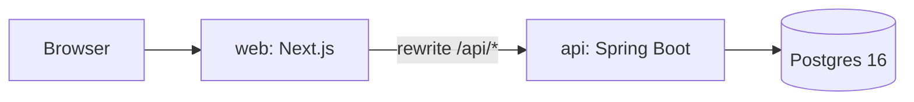

# ClearPath Review

An internal tool for reviewing marketing material at ClearPath Financial (personal loans, credit cards, mortgage prequalification, including affiliate partner content). A marketer uploads a PDF, picks the product and starts that product's workflow. The workflow assigns each step to whole groups (Marketing, Legal, Compliance, ...). Reviewers see their assignments in the task list pane, open the material, read the file, comment and approve for their group. When every required approval on a step is in, the next step opens; when the last step finishes the version is approved until a set date. Uploading a new file during an active review sends everyone back to step 1, and the task list shows which reviews have been sitting.

The product spec lives in [DESIGN.md](./DESIGN.md) and the engineering contract in [IMPLEMENTATION.md](./IMPLEMENTATION.md). The HTTP API is defined in [contracts/openapi.yaml](./contracts/openapi.yaml).

## Architecture



- **`web/`**: Next.js 15 (App Router), React 19, TypeScript, Tailwind 4, shadcn/ui, TanStack Query, `react-pdf`, MSW for the mock backend.
- **`api/`**: Spring Boot 3, Java 21, Gradle, Flyway migrations, PDFBox for the seed PDFs, Testcontainers for tests.
- **Postgres**: all data, including PDF bytes (`file_blob.bytes`).
- The browser only talks to the Next.js origin. `web/next.config.ts` rewrites `/api/*` to `API_URL`, so the `HttpOnly` session cookie stays on the web origin and there is no CORS.
- Expiry has no cron job: `approved_until` is evaluated on read, and "expired" notifications are inserted lazily.

## Repo layout

| Path | Purpose |
| --- | --- |
| `web/` | Frontend. See [web/README.md](./web/README.md) and [web/lib/README.md](./web/lib/README.md) for components, data layer and the mock backend |
| `api/` | Backend. See [api/README.md](./api/README.md) |
| `contracts/openapi.yaml` | Single source of truth for the HTTP API (the web client types are generated from it) |
| `docker-compose.yml` | Postgres 16 for local development |
| `DESIGN.md`, `IMPLEMENTATION.md` | Product design and build spec |

## Quickstart (full stack)

Prerequisites: Java 21, Node 20+, and either Docker or a local Postgres 16.

1. **Postgres.** Either use docker-compose:

   ```bash
   docker compose up -d postgres
   ```

   or create a local database matching the defaults (`clearpath` database, `clearpath` user and password `clearpath` on `localhost:5432`). Override with `SPRING_DATASOURCE_URL`, `SPRING_DATASOURCE_USERNAME` and `SPRING_DATASOURCE_PASSWORD`.

2. **API** (port 8080). The `seed` profile runs Flyway and loads the demo data:

   ```bash
   cd api
   ./gradlew bootRun --args='--spring.profiles.active=seed'
   ```

   Health check: `curl http://localhost:8080/api/health`. Set `SESSION_SECRET` for anything other than local use.

3. **Web** (port 3000):

   ```bash
   cd web
   npm install
   API_URL=http://localhost:8080 npm run dev
   ```

   Open <http://localhost:3000>.

### Demo accounts

Every seeded account uses the password `demo-demo`. Emails are `<first>.<last>@clearpath.example`; the login screen lists everyone, and the header user switcher lets you change who you are acting as.

| Person | Groups |
| --- | --- |
| Maya Chen (owner of the walkthrough material), Morgan Taylor, Casey Brooks | Marketing |
| James Rivera, Sofia Patel | Legal |
| Alex Kim, Jordan Lee | Compliance |
| Riley Davis | Legal and Compliance (gets the "Approve as..." picker) |

Walkthrough to rehearse: sign in as James, open the overdue affiliate personal-loan email from Your tasks, switch to a Legal user and Approve (stepper 1/2), switch to the owner and upload v3 (review restarts at step 1), then switch through the remaining reviewers until the current version shows Approved with an until-date.

## UI only, with mocks

The web app can run without the API or a database. `NEXT_PUBLIC_API_MOCKS=1` starts an in-browser MSW backend with the same seed data and rules (state resets on page reload; the signed-in user survives a reload):

```bash
cd web
NEXT_PUBLIC_API_MOCKS=1 npm run dev
```

## Tests

API (Testcontainers when Docker is available, otherwise point at a database):

```bash
cd api
TEST_DATABASE_URL=jdbc:postgresql://localhost:5432/clearpath_test ./gradlew test
```

Web:

```bash
cd web
npm run typecheck
npm run lint
npm test                                              # vitest unit tests
npm run build
npm run e2e:mocks                                     # Playwright against the mock backend (starts its own dev server)
npm run e2e                                           # Playwright against a running API (see playwright.config.ts)
```

`MOCKS_PORT` picks the port used by the mocks Playwright config. `npm run generate:api` regenerates the API types from `contracts/openapi.yaml`.

## Hosting notes

The target is a free-tier split (see [IMPLEMENTATION.md](./IMPLEMENTATION.md) section 1.2):

| Piece | Where | Notes |
| --- | --- | --- |
| `web/` | Vercel Hobby | Connect the GitHub repo; set `API_URL` to the deployed Spring base URL. It is read at build time, so set it for the build, not only at runtime |
| `api/` | Render free web service, Railway or Fly.io | Spring Boot JAR or Docker. Expect cold starts on Render's free tier |
| Postgres | Neon, Supabase or Render free Postgres | Pass the connection string via `SPRING_DATASOURCE_*`; Flyway runs on startup |

Vercel's free tier cannot run the Spring Boot JVM or host Postgres, which is why the API and database live elsewhere.
