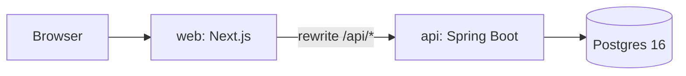

# ClearPath Review

An internal tool for reviewing marketing material at ClearPath Financial (personal loans, credit cards, mortgage prequalification, including affiliate partner content). A marketer uploads a PDF, picks the product and starts that product's workflow. The workflow assigns each step to whole groups (Marketing, Legal, Compliance, ...). Reviewers see their assignments in the task list pane, open the material, read the file, comment and approve for their group. When every required approval on a step is in, the next step opens; when the last step finishes the version is approved until a set date. Uploading a new file during an active review sends everyone back to step 1, and the task list shows which reviews have been sitting.

The product spec lives in [DESIGN.md](./DESIGN.md) and the engineering contract in [IMPLEMENTATION.md](./IMPLEMENTATION.md). The HTTP API is defined in [contracts/openapi.yaml](./contracts/openapi.yaml).

## Architecture



- **`web/`**: Next.js 15 (App Router), React 19, TypeScript, Tailwind 4, shadcn/ui, TanStack Query, `react-pdf`, MSW for the mock backend.
- **`api/`**: Spring Boot 3, Java 21, Gradle, Flyway migrations, PDFBox for the seed PDFs, Testcontainers for tests.
- **Postgres**: all data, including PDF bytes (`file_blob.bytes`).
- The browser only talks to the Next.js origin. `web/next.config.ts` rewrites `/api/*` to `API_URL`, so the `HttpOnly` session cookie stays on the web origin and there is no CORS.
- Expiry has no cron job: `approved_until` is evaluated on read, and "expired" notifications are inserted lazily.

## Repo layout

| Path | Purpose |
| --- | --- |
| `web/` | Frontend. See [web/README.md](./web/README.md) and [web/lib/README.md](./web/lib/README.md) for components, data layer and the mock backend |
| `api/` | Backend. See [api/README.md](./api/README.md) |
| `contracts/openapi.yaml` | Single source of truth for the HTTP API (the web client types are generated from it) |
| `docker-compose.yml` | Postgres 16 for local development |
| `DESIGN.md`, `IMPLEMENTATION.md` | Product design and build spec |

## Quickstart (full stack)

Prerequisites: Java 21, Node 20+, and either Docker or a local Postgres 16.

1. **Postgres.** Either use docker-compose:

   ```bash
   docker compose up -d postgres
   ```

   or create a local database matching the defaults (`clearpath` database, `clearpath` user and password `clearpath` on `localhost:5432`). Override with `SPRING_DATASOURCE_URL`, `SPRING_DATASOURCE_USERNAME` and `SPRING_DATASOURCE_PASSWORD`.

2. **API** (port 8080). The `seed` profile runs Flyway and loads the demo data:

   ```bash
   cd api
   ./gradlew bootRun --args='--spring.profiles.active=seed'
   ```

   Health check: `curl http://localhost:8080/api/health`. Set `SESSION_SECRET` for anything other than local use.

3. **Web** (port 3000):

   ```bash
   cd web
   npm install
   API_URL=http://localhost:8080 npm run dev
   ```

   Open <http://localhost:3000>.

### Demo accounts

Every seeded account uses the password `demo-demo`. Emails are `<first>.<last>@clearpath.example`; the login screen lists everyone, and the header user switcher lets you change who you are acting as.

| Person | Groups |
| --- | --- |
| Maya Chen (owner of the walkthrough material), Morgan Taylor, Casey Brooks | Marketing |
| James Rivera, Sofia Patel | Legal |
| Alex Kim, Jordan Lee | Compliance |
| Riley Davis | Legal and Compliance (gets the "Approve as..." picker) |

Walkthrough to rehearse: sign in as James, open the overdue affiliate personal-loan email from Your tasks, switch to a Legal user and Approve (stepper 1/2), switch to the owner and upload v3 (review restarts at step 1), then switch through the remaining reviewers until the current version shows Approved with an until-date.

## UI only, with mocks

The web app can run without the API or a database. `NEXT_PUBLIC_API_MOCKS=1` starts an in-browser MSW backend with the same seed data and rules (state resets on page reload; the signed-in user survives a reload):

```bash
cd web
NEXT_PUBLIC_API_MOCKS=1 npm run dev
```

## Tests

API (Testcontainers when Docker is available, otherwise point at a database):

```bash
cd api
TEST_DATABASE_URL=jdbc:postgresql://localhost:5432/clearpath_test ./gradlew test
```

Web:

```bash
cd web
npm run typecheck
npm run lint
npm test                                              # vitest unit tests
npm run build
npm run e2e:mocks                                     # Playwright against the mock backend (starts its own dev server)
npm run e2e                                           # Playwright against a running real stack (E2E_BASE_URL)
./scripts/e2e-real.sh                                 # fresh DB + API + web + Playwright + teardown (see web/e2e/README.md)
```

`MOCKS_PORT` picks the port used by the mocks Playwright config. `npm run generate:api` regenerates the API types from `contracts/openapi.yaml`.

## Deployment (Vercel + Render + Neon)

Production uses a free-tier split: Next.js on **Vercel**, Spring Boot on **Render** (Docker), Postgres on **Neon**. The browser only talks to the Vercel origin; `web/next.config.ts` rewrites `/api/*` to the Render API base URL.

### 1. Postgres (Neon)

1. Create a Neon project and database (Postgres 16).
2. Copy the **pooled or direct** connection string (`postgresql://…?sslmode=require`).
3. You will paste this into Render as `DATABASE_URL` (see below). Flyway runs automatically when the API starts.

**Render Postgres (optional):** `render.yaml` includes a commented-out `databases:` block if you prefer Render-managed Postgres instead of Neon. Create the DB, then set the web service `DATABASE_URL` to Render’s connection string.

### 2. API (Render)

1. Push this repo to GitHub.
2. In [Render](https://render.com), **New → Blueprint** and select the repo. Render reads [`render.yaml`](./render.yaml) at the repo root.
3. When prompted, set **`DATABASE_URL`** (sync: false) to your Neon connection string.
4. Render generates **`SESSION_SECRET`** (`generateValue: true`). Other prod env vars are set in the blueprint:
   - `SPRING_PROFILES_ACTIVE=prod`
   - `SESSION_COOKIE_SECURE=true` (session cookie must be `Secure` over HTTPS via the Vercel proxy)
   - `SEED_ON_STARTUP=true` (idempotent demo seed on first boot)
5. Deploy. Health check: `GET /api/health` → `{ "status": "ok" }`.
6. Note the public URL (e.g. `https://clearpath-api.onrender.com`) — no trailing slash.

**Cold starts:** Render’s free web service spins down after inactivity. The first request after idle can take 30–60+ seconds; health checks and user logins may time out briefly.

**Docker locally:** [`api/Dockerfile`](./api/Dockerfile) builds with `./gradlew bootJar` on JDK 21 and runs on JRE 21 slim with non-root user, `PORT`, and JVM flags sized for ~512 MB instances.

### 3. Web (Vercel)

1. Import the GitHub repo in [Vercel](https://vercel.com).
2. Set **Root Directory** to `web`.
3. Framework preset: **Next.js** (see [`web/vercel.json`](./web/vercel.json)).
4. Add **Environment Variable** for **Production** (and Preview if desired):

   | Name | Example | Where |
   | --- | --- | --- |
   | `API_URL` | `https://clearpath-api.onrender.com` | Vercel project → Settings → Environment Variables |

   **`API_URL` is read at build time** in `next.config.ts` when rewrites are generated. Changing it in the Vercel dashboard does **not** affect an already-built deployment until you **trigger a new production deploy** (Redeploy).

5. Deploy. Open the Vercel URL and sign in with a demo account (below).

### Environment variables (reference)

| Variable | Required | Set on | Purpose |
| --- | --- | --- | --- |
| `DATABASE_URL` | Prod API | Render | Neon/Postgres URI (`postgres://` or `postgresql://…`); converted to JDBC at startup when `SPRING_DATASOURCE_URL` is unset |
| `SPRING_DATASOURCE_URL` | Optional | Render / local | Explicit JDBC URL; overrides `DATABASE_URL` conversion |
| `SPRING_DATASOURCE_USERNAME` | Optional | Render / local | DB user (omitted when using `DATABASE_URL` with embedded credentials) |
| `SPRING_DATASOURCE_PASSWORD` | Optional | Render / local | DB password |
| `SESSION_SECRET` | **Prod** | Render | HMAC key for `clearpath_session`; app **fails fast** on `prod` if missing or still the dev default |
| `SESSION_COOKIE_SECURE` | Prod | Render (`true`) | `Set-Cookie` `Secure` flag; use `true` behind Vercel HTTPS |
| `SEED_ON_STARTUP` | Optional | Render (`true` in blueprint) | Run idempotent demo seed once at boot in prod |
| `SPRING_PROFILES_ACTIVE` | Prod | Render (`prod`) | Production profile |
| `PORT` | Render | Render (injected) | HTTP port; mapped to `server.port` |
| `API_URL` | **Web build** | Vercel | Spring base URL for `/api` rewrites (no trailing slash) |
| `SERVER_PORT` | Local | Shell | Local API port (default `8080`) |
| `TEST_DATABASE_URL` | CI / tests | GitHub Actions, local | JDBC URL for API tests when Docker/Testcontainers is unavailable |

Local defaults remain `jdbc:postgresql://localhost:5432/clearpath` with user/password `clearpath` (see Quickstart).

### Demo accounts (after seed)

Same as local: password **`demo-demo`**, emails `<first>.<last>@clearpath.example` (listed on the login screen). With `SEED_ON_STARTUP=true`, a fresh Neon database is populated automatically on first API boot.

### Re-seed or reset demo data

- **Prod (no shell):** Truncate app tables in Neon (or drop/recreate the database), redeploy the API with `SEED_ON_STARTUP=true` — seed is idempotent and skips if marker user exists.
- **Local:** `./gradlew bootRun --args='--spring.profiles.active=seed --seed.reset=true'` (truncates demo tables then reloads).

### Upload size and Vercel limits

The API accepts PDF uploads up to **50 MB** (`spring.servlet.multipart` in `application.yml`). Next.js sets `experimental.middlewareClientMaxBodySize: "50mb"` for middleware.

Vercel **serverless/Edge Functions** have a **~4.5 MB request body limit** on Hobby. **`/api/*` requests from the browser are rewritten to the external Render origin** (see `next.config.ts`), not handled as Vercel serverless route handlers. In typical Next.js deployments, such **external rewrites are proxied to the origin** and are **not** subject to the serverless payload cap — but Vercel’s exact behavior can vary by plan and routing path. **If large uploads fail through the Vercel proxy**, the fallback is to call the Render API origin directly from the browser with CORS and `Secure` cookies on separate sites (not implemented here; session auth assumes same-site proxy).

### Troubleshooting

| Symptom | Likely cause | Fix |
| --- | --- | --- |
| Login succeeds then immediate 401 | Cookie not stored | Ensure `SESSION_COOKIE_SECURE=true` on Render when using HTTPS Vercel; check browser blocks third-party cookies (should be same-site via rewrite) |
| API calls hit wrong host | Stale `API_URL` | Set `API_URL` on Vercel and **redeploy** the web project |
| API won’t start on Render | Invalid/missing `DATABASE_URL` or `SESSION_SECRET` | Check Render logs; verify Neon URL and that `SESSION_SECRET` is not the dev default |
| Timeouts after idle | Render free cold start | Retry; upgrade plan or use a cron ping (not included) |
| Health check fails | DB unreachable or Flyway error | Verify Neon IP allow / SSL[`sslmode=require`] in URL |

See also [IMPLEMENTATION.md](./IMPLEMENTATION.md) §1.2 for architecture context.
